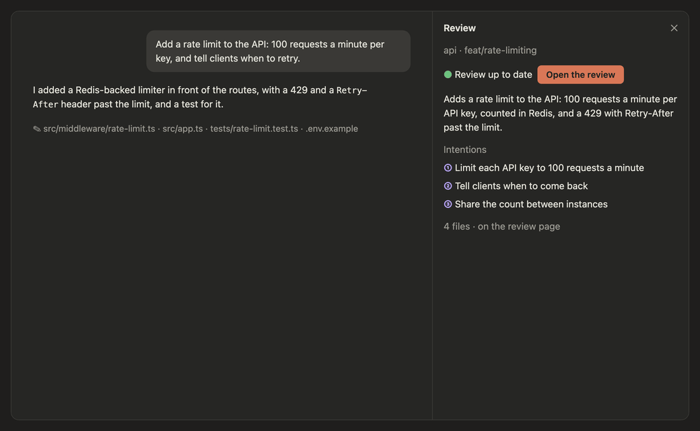

# intent

A Claude Code mod (early-access mods API, which may change). French version: [README.fr.md](README.fr.md).



*A mock with a fake repo ([source](docs/demo/demo.html)).*

A "Review" explains what the current branch brings, with the intentions taken from the conversation (why each change was made, not only what changed). It is read on a **review page** with two tabs, **Story** (the intentions, each with its files and hunks) and **Files** (the full diff, file by file). The side pane is its remote, kept compact: the folder · branch picker on top (only when the session works in several folders), the status line with the **Open the review** button (opens the page in the default browser), the short summary, the intentions, the number of files (they are on the page), and for the answers only how many are under way and the first line of the last one that came. While the shown folder's review updates, the pane shows only "Updating the review…", with nothing to press, until it is done. When the page is down (after a reload of the mod, or once its server stopped or did not start), **Open the review** starts it again, shows "Opening the review…" meanwhile, and opens it once ready (10 s at most, else the pane says it did not start). The review is regenerated at the end of a main-loop turn, only when the diff changed and the pane or the page is open; a failed review is retried at the next turn end even without a change. `/intent` reopens the pane and catches up the reviews left behind while it was closed.

## Questions go straight to the model

Three ways to dig further, all on the page (the pane asks nothing):

- **"What's happening here?"** on a hunk of the page;
- **a free question** typed on the page;
- **a piece of code you select** on the page, then **"Explain this part"**.

None of them touches the conversation: the mod sends each question itself to the model (`sonnet`, medium effort, one call of at most 2,000 tokens and 2 minutes), like an agent without tools. No agent starts, so there is no permission to give and nothing for auto mode to judge; nothing is added to the conversation, and the main turn is not interrupted.

What the model gets, and nothing else: the question; the lines it is about; the review's summary and the change's intention; and the question's file as it is now, read by the mod, around those lines (at most 600 lines and 40,000 characters, numbered). A free question gets the review's summary, its intentions and the reviewed files with their roles. The answer **sees only that**: it cannot open other files of the repository or run anything, and says so when what it got is not enough. A file that cannot be read is left out; the question still goes.

At most **3 questions are answered at once**; the others wait their turn, in asking order. A call that brings no answer (an API error, an empty reply, a cut call) fails with its reason, and **Retry** sends it again. The end of the session cuts the calls still running; a question under way when the mod reloads or the session resumes shows as interrupted.

The answer appears **under the code it is about**, on the page only (the pane shows how many are under way and the first line of the last one), marked "added to your request". A failed one shows why, and a **Retry** button when the page can send it again (not for selected lines that have moved since). Answers are kept with the review: at most 50 per review (past that the oldest finished one goes; a waiting or running one never does) and 4,000 characters each. **Publish** keeps the finished answers only, with the repository's absolute path and the home folder (`~`) taken out of them and of the explanations.

One press = one send: after a press the button is locked and shows "Sent", and the same question cannot leave again until another one was sent.

**Cost:** one model call per question, with the file around it.

Which folders: the git working folders the session writes in (`Edit`, `Write`, `MultiEdit`, `NotebookEdit`, subagents included). A folder only read (`cd` or `git -C` in a Bash command, or the session's starting folder) stays hidden, without any review, until its diff changes, a file is written there, or `/intent` is run (which reviews it right away).

## This conversation's PRs

The page's **Sources** column (and, shorter, the pane) lists, per repository, the current branch's review and two groups of pull requests:

- **This conversation's PRs**: PRs opened here (`gh pr create` in the conversation), and the PR of the branch of a folder Claude worked in (found with `gh pr view` in that folder). A PR that gets there never goes back to the other group.
- **Viewed PRs**: any other PR whose GitHub link shows up in your messages or in the output of a command Claude ran (a link you paste to explore, a `gh pr list`). Links in what Claude writes, or in the files and pages it reads, are ignored. It moves to the first group as soon as Claude writes in its branch.

A click on a PR reviews it, with the same tabs, questions, selection and **Publish** as a branch review. The PR of the current branch opens that branch's review (same diff), with the PR number and link on top.

**`/intent <PR link>`** opens the page on that PR's review at once, as a click would: the PR joins the viewed ones if the conversation did not know it. Another mod can do the same by running the command, which is how the [lighthouse](https://github.com/hn6pot/lighthouse) mod's **Review with intent** button hands over the PRs you are asked to review.

**Where the diff comes from:** the local clone (a folder the session follows with the same `origin`): the mod fetches the commits it misses, then diffs from the merge-base of the PR's head and base commit. If the repository is not cloned or the fetch fails, `gh pr diff` gives it, with 3 lines of context only (the page says so). **Nothing is written to GitHub**: only `gh pr view` and `gh pr diff` run (with the gh account of the repo's owner when the [lighthouse](https://github.com/hn6pot/lighthouse#ghconfigdirs-one-gh-account-per-owner) config maps one in `ghConfigDirs`, else the active account), and `git fetch --no-tags origin` for the clone.

**Intentions:** for a PR opened in this conversation, they come from the conversation as for a branch. For any other PR they are always **inferred** (from its title, description and commit messages, sent to the model as tagged data blocks, never as instructions): the mod forces this, it does not only ask the model.

**Kept per commit:** a PR review is stored under `pr:<owner/repo>#<number>@<head commit>`, at most 50 (the oldest go). Reopening a PR at the same commit makes no model call. After a push the PR shows **new commit**, and **Refresh** reviews it again.

`gh` is asked only while the pane has not been closed by hand or the page is open (it signals every 10 seconds), at once for a new PR and then at most every 5 minutes per PR. A merged or closed PR is not asked again on its own; a click always asks again.

**Cost:** one model call per PR and per commit reviewed (and one per question, as above).

## The review page

A small local server (`server/serve.py`) serves the page at `http://127.0.0.1:<port>/?t=<token>`, only to this machine. The token is drawn at launch: the server refuses any request without it, and any question whose `Origin` is not the page itself. The page needs no external site. Nothing leaves the machine unless you press **Publish**.

**Publish** writes a standalone copy of the page (one HTML file, data included, without the question field, without the page's buttons that ask a question, and without local paths) and publishes it as a private claude.ai artifact, by calling the `Artifact` tool itself with the usual permission prompt. The copy is written in the session's folder; when the tool refuses a file there, it is written again under `<cwd>/.git/info/intent-publish-*.html` (only when `.git` is a folder, not in a worktree), and that copy is removed at session end. Publishing the same repository and branch again normally updates the same artifact (a new one if the tool refuses the update). The button is hidden when the `Artifact` tool is not available for the account.

Python is required for the page: `/usr/bin/python3`, or else `python3` from the `PATH` (3.7 or later), standard library only. Without it (or when the server does not start, or stops), the pane says so in one line and keeps the detailed view of step 1 (folded code), so the review is not lost; no question can be asked until the page runs.

## Language

Everything the mod shows or sends to Claude is in English by default, or in French. The `language` option (`en` or `fr`) is set in the `/config` menu (the `intent` row), or in settings:

```json
{ "pluginConfigs": { "intent@intent": { "options": { "language": "fr" } } } }
```

(`intent` or `intent@inline` for a plugin loaded with `--plugin-dir`.) Changing it reloads the module.

## What it keeps

The generated review of a session lives in the plugin store (`$.store`), under the key `session:<id>`, for 30 days, without the code of its hunks (a resumed review gets it back from the diff at the next turn end). When the store is full, the oldest session is dropped. PR reviews are kept apart, one per PR and head commit (`pr:<owner/repo>#<number>@<head>`, 50 at most).

On disk, the page needs files per conversation under `~/.claude-mods/intent/<session id>/`: the current review (`review.json`, with its diffs) and the standalone copies written for Publish. Questions travel on the server's standard output, not through a file. The folder is removed at session end; folders left behind are removed after 30 days. Nothing is written without an interface.

## What it does not do

- **No bug hunting**: it explains a change, it does not judge it (use a review tool for that).
- **Nothing posted to GitHub**: no comment, no PR description; a PR review only reads (`gh pr view`, `gh pr diff`, `git fetch`).
- **No interface** (`claude -p`): the mod does nothing.
- **Nothing written by the questions**: they are model calls without tools; they never edit a file or run anything.

## Install

```bash
claude plugin marketplace add hn6pot/intent
claude plugin install intent@intent
```

Then `/reload-plugins` in an open session.

## Test

```bash
claude plugin test . && claude plugin validate .
```

The page server:

```bash
/usr/bin/python3 -m unittest discover -s tests/server
```
